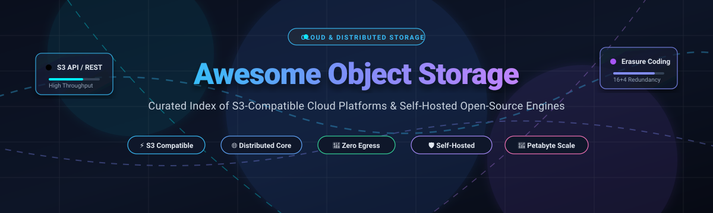
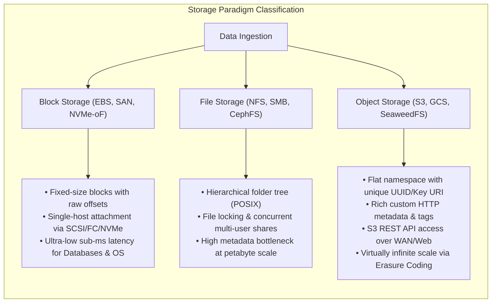

<p align="center">
  
</p>

<p align="center">
  <a href="https://github.com/ishandutta2007/Awesome-Awesome-Awesome"></a>
  <a href="https://discord.gg/jc4xtF58Ve"></a>
  <a href="https://github.com/ishandutta2007/Awesome-Object-Storage/stargazers"></a>
  <a href="https://github.com/ishandutta2007/Awesome-Object-Storage/network/members"></a>
  <a href="https://github.com/ishandutta2007/Awesome-Object-Storage/blob/main/LICENSE"></a>
  <a href="https://github.com/ishandutta2007/Awesome-Object-Storage/pulls"></a>
  <a href="https://github.com/ishandutta2007"></a>
</p>

---

# 📦 Awesome Object Storage [](https://github.com/ishandutta2007/Awesome-Awesome-Awesome)

> **A definitive, SEO-curated index of Enterprise SaaS Cloud Platforms and Self-Hosted Open-Source Object Storage Engines.**  
> Focused on **S3 API Compatibility**, **Erasure Coding**, **Zero-Egress Data Lakes**, **Distributed Clustering**, and **Data Sovereignty**.

Object storage systems store and retrieve unstructured data — machine learning datasets, video assets, container images, log archives, database backups, and static web assets — via RESTful HTTP APIs (predominantly the Amazon S3 standard) across a flat namespace without hierarchical filesystem overhead.

---

## 📑 Table of Contents
- [📊 Sector Overview & Market Dynamics](#-sector-overview--market-dynamics)
- [☁️ SaaS & Hosted Object Storage Platforms](#️-saas--hosted-object-storage-platforms)
- [💻 Open-Source Object Storage Engines](#-open-source-object-storage-engines)
  - [1. MinIO](#1-minio)
  - [2. SeaweedFS](#2-seaweedfs)
  - [3. RustFS](#3-rustfs)
  - [4. Ceph RADOS Gateway (RGW)](#4-ceph-rados-gateway-rgw)
  - [5. CubeFS](#5-cubefs)
  - [6. lakeFS](#6-lakefs)
  - [7. Garage](#7-garage)
  - [8. Storj](#8-storj)
  - [9. OpenStack Swift](#9-openstack-swift)
  - [10. Zenko CloudServer](#10-zenko-cloudserver)
  - [11. LeoFS](#11-leofs)
  - [12. Apache Ozone](#12-apache-ozone)
  - [13. Riak CS](#13-riak-cs)
  - [14. Kypello](#14-kypello)
- [🧩 Architectural Comparison & Decision Matrix](#-architectural-comparison--decision-matrix)
- [🔍 Object vs Block vs File Storage: Core Differences](#-object-vs-block-vs-file-storage-core-differences)
- [❓ Frequently Asked Questions (FAQ)](#-frequently-asked-questions-faq)
- [🤝 How to Contribute](#-how-to-contribute)
- [⭐ Star History](#-star-history)
- [💖 Support & Sponsorship](#-support--sponsorship)
- [📜 Disclaimer](#-disclaimer)

---

## 📊 Sector Overview & Market Dynamics

The global cloud object storage sector was valued at **$38.5 Billion in 2024** and is projected to expand to **$105.8 Billion by 2030**, compounding at a **CAGR of ~18.5%**, propelled by explosive AI/ML dataset ingestion, video streaming workloads, and regulatory compliance archiving.

The sector demonstrates a **bimodal market structure**:
1. **Hyperscaler Concentration (Winner-Take-Most Tier)**: The public cloud tier is **highly concentrated** among hyperscalers — Amazon Web Services (S3), Microsoft Azure (Blob), and Google Cloud (GCS) hold over **68% aggregate market share**. Their dominant position is defended by massive compute adjacency (EC2, EMR, BigQuery, SageMaker) and steep data egress penalties that create formidable data gravity lock-in.
2. **Standardization-Driven Fragmentation (Challenger & Sovereign Tier)**: Conversely, the storage protocol layer has completely converged around the **de facto Amazon S3 REST API standard**. This API monoculture has ignited rapid **fragmentation** across two high-growth segments:
   - **Zero-Egress Challenger Clouds** (Cloudflare R2, Backblaze B2, Wasabi) that dismantle hyperscaler margins by eliminating bandwidth egress tolls.
   - **Self-Hosted Sovereign Open-Source Engines** (Ceph, SeaweedFS, RustFS, Garage) deployed on bare-metal and Kubernetes for local AI model training, sovereign data residency, and sub-millisecond local latency — especially urgent since **MinIO's Community Edition entered maintenance mode in December 2025**.

---

## ☁️ SaaS & Hosted Object Storage Platforms

*Below is a comprehensive comparison of leading SaaS object storage providers, sorted descending by **Company Size (Market Capitalization / Corporate Valuation)**.*

| Platform / Service | Parent Company | Company Size (Valuation / Revenue) | Starting Tier Pricing | Free Tier / Free Trial Limits | Key Protocol & Architectural Highlights |
| :--- | :--- | :--- | :--- | :--- | :--- |
| **[Azure Blob Storage](https://azure.microsoft.com/services/storage/blobs/)** | Microsoft | **~$3.1 Trillion** (Market Cap) / FY24 Rev: $245B | **$0.0184 / GB / month** (Hot LRS tier, first 50 TB in US East); Cool tier: $0.01/GB; Archive: $0.00099/GB | **12-Month Free Account**: 5 GB LRS Hot Block Blob storage, 20,000 read & 10,000 write operations/month, plus **$200 credit** for the first 30 days. | Native ADLS Gen2 hierarchical namespace, deep Microsoft Fabric/Synapse integration, immutable WORM policies. |
| **[Google Cloud Storage](https://cloud.google.com/storage)** | Alphabet / Google | **~$2.1 Trillion** (Market Cap) / FY24 Rev: $350B | **$0.020 / GB / month** (Standard tier in US multi-region); Nearline: $0.010/GB; Coldline: $0.004/GB; Archive: $0.0012/GB | **Free Forever Tier**: 5 GB-months of Standard Storage in `us-east1`, `us-west1`, or `us-central1`, 5,000 Class A & 50,000 Class B ops, 100 GB egress to NA, plus **$300 credit** for 90 days. | Strong global consistency, dual-region high availability buckets, direct Turbo Replication, native BigQuery ingestion. |
| **[Amazon S3](https://aws.amazon.com/s3/)** | Amazon / AWS | **~$2.0 Trillion** (Market Cap) / FY24 AWS Rev: $105B | **$0.023 / GB / month** (S3 Standard, first 50 TB in US East); S3 Express One Zone: $0.16/GB (single-digit ms latency); Glacier Deep Archive: $0.00099/GB | **12-Month Free Tier**: 5 GB S3 Standard storage, 20,000 GET requests, 2,000 PUT/COPY/POST requests, and 100 GB data transfer out per month. | The industry reference standard. 11 9's durability (99.999999999%), S3 Object Lambda, S3 Tables (Apache Iceberg integration), S3 Express One Zone. |
| **[Cloudflare R2](https://www.cloudflare.com/products/r2/)** | Cloudflare | **~$35 Billion** (Market Cap) / FY24 Rev: $1.67B | **$0.015 / GB / month** storage; $0.36 / million Class A operations (writes); $0.036 / million Class B operations (reads); **$0.00 / GB Egress (Zero Egress Fees)** | **Free Forever Tier**: 10 GB storage per month, 1,000,000 Class A operations/month, 10,000,000 Class B operations/month, and **completely free egress worldwide**. | Zero egress tolls, globally distributed edge caching via Cloudflare Workers, automatic object migration via Super Slurper. |
| **[Scaleway Object Storage](https://www.scaleway.com/en/object-storage/)** | Iliad Group / Scaleway | **~$12 Billion** (Valuation) / Iliad FY24 Rev: €10.2B | **€0.014 / GB / month** (~$0.015/GB/month) Multi-AZ Standard in Paris; €0.002 / GB / month (Glacier cold storage); €0.01/GB egress beyond allowance | **Free Forever Tier**: 75 GB of Multi-AZ Standard storage and 75 GB of outbound transfer free per month across all accounts. | European data sovereignty (GDPR certified), multi-AZ durability, Paris/Amsterdam/Warsaw regions, S3 API parity. |
| **[DigitalOcean Spaces](https://www.digitalocean.com/products/spaces)** | DigitalOcean | **~$3.5 Billion** (Market Cap) / FY24 Rev: $730M | **$5.00 / month flat base plan** (includes 250 GB storage + 1 TB outbound transfer). Additional storage: $0.02/GB/month; additional transfer: $0.01/GB | **60-Day Free Trial**: **$200 credit** valid for 60 days to spin up Spaces object storage and Droplets. | Built-in CDN with 25 edge PoPs, automated SSL certificates, straightforward predictable team billing, simple S3 API endpoint. |
| **[Wasabi Hot Cloud Storage](https://wasabi.com/)** | Wasabi Technologies | **~$1.1 Billion** (Private Unicorn Valuation, Series D) | **$0.0069 / GB / month** ($6.99 / TB / month flat rate); **$0.00 egress fees**; **$0.00 API request charges** (minimum 1 TB / 90-day retention policy) | **30-Day Free Trial**: Up to 1 TB of fully featured storage with zero egress fees and full S3 API support; no payment card required upfront. | Pure-play hot storage with no tiered latency delays, multi-cloud direct connect, WORM immutable object locking, single tier simplicity. |
| **[Backblaze B2](https://www.backblaze.com/cloud-storage)** | Backblaze | **~$250 Million** (Market Cap - NASDAQ: BLZE) / FY24 Rev: $128M | **$0.0060 / GB / month** ($6.00 / TB / month) storage; Free egress up to 3x average monthly storage ($0.01/GB thereafter) | **Free Forever Tier**: 10 GB free cloud storage, 2,500 Class A API calls/day, 2,500 Class B/C calls/day, and 1 GB/day free download egress. | Extreme cost advantage (~1/4 AWS S3 price), Cloudflare Bandwidth Alliance (100% free egress to Cloudflare CDN), Universal Data Migration. |

---

## 💻 Open-Source Object Storage Engines

*Below is an expanded list of notable open-source object storage and distributed data repository engines, sorted descending by **GitHub Stargazers count**.*

---

### 1. MinIO
<a href="https://github.com/minio/minio/stargazers"></a>
- **Repository**: [minio/minio](https://github.com/minio/minio)
- **License**: AGPL-3.0
- **Language**: Go
- **Primary Architecture**: Single-binary distributed object storage engine with Reed-Solomon Erasure Coding (SIMD-accelerated AVX-512).
- **Core Strengths**: De facto benchmark for S3 API compatibility; native Kubernetes Operator integration; multi-gigabyte/sec throughput per node.
- **Operational Reality**: **Community Edition entered maintenance mode in December 2025**; security patches are evaluated selectively, and enterprise identity features (OIDC/SAML/SSO UI) were decoupled into commercial MinIO Enterprise.
- **Ideal Use Case**: Existing private cloud clusters, air-gapped test environments, and legacy deployments with grandfathered operational pipelines.

---

### 2. SeaweedFS
<a href="https://github.com/seaweedfs/seaweedfs/stargazers"></a>
- **Repository**: [seaweedfs/seaweedfs](https://github.com/seaweedfs/seaweedfs)
- **License**: Apache-2.0
- **Language**: Go
- **Primary Architecture**: Facebook Haystack-inspired architecture with separated Volume Servers and Master metadata nodes, complemented by an append-only log model.
- **Core Strengths**: **O(1) disk seeks** regardless of dataset size (billions of small files or massive large blobs); serves S3 API, POSIX mount (FUSE), Hadoop HDFS, and Apache Iceberg tables from the identical underlying data blocks without duplicate synchronization.
- **Operational Reality**: Volume compaction requires disk headroom; customizable erasure coding (e.g., 20+4) enables high storage efficiency (1.2× raw storage overhead).
- **Ideal Use Case**: Unified lakehouse clusters, computer vision training image pipelines, video assets, and organizations unifying object and POSIX filesystem workflows.

---

### 3. RustFS
<a href="https://github.com/rustfs/rustfs/stargazers"></a>
- **Repository**: [rustfs/rustfs](https://github.com/rustfs/rustfs)
- **License**: Apache-2.0
- **Language**: Rust
- **Primary Architecture**: Modern memory-safe asynchronous multi-threaded storage engine designed specifically as a high-performance open-source alternative to MinIO and Ceph.
- **Core Strengths**: Low memory footprint; zero garbage-collection pauses; drop-in S3 API compatibility; native live-migration tooling from existing MinIO buckets.
- **Operational Reality**: Active and rapidly evolving codebase with frequent minor version releases; benchmark test suites recommended before production deployment.
- **Ideal Use Case**: Cloud-native Kubernetes clusters, edge nodes, and teams modernizing storage infrastructure with Rust's memory safety and concurrency guarantees.

---

### 4. Ceph RADOS Gateway (RGW)
<a href="https://github.com/ceph/ceph/stargazers"></a>
- **Repository**: [ceph/ceph](https://github.com/ceph/ceph)
- **License**: LGPL-2.1
- **Language**: C++
- **Primary Architecture**: Ceph's Reliable Autonomic Distributed Object Store (RADOS) paired with the RADOS Gateway (RGW) REST interface daemon.
- **Core Strengths**: Battle-tested across thousands of enterprise and telecom data centers at petabyte-to-exabyte scales; unified unified block (RBD), file (CephFS), and object (RGW) architecture; CRUSH algorithm eliminates centralized metadata bottlenecks.
- **Operational Reality**: High operational complexity requiring dedicated storage administrators to manage Monitors (MON), Managers (MGR), and OSD daemons.
- **Ideal Use Case**: Large enterprise data centers, OpenStack deployments, telco clouds, and large-scale multi-petabyte unified storage infrastructures.

---

### 5. CubeFS
<a href="https://github.com/cubefs/cubefs/stargazers"></a>
- **Repository**: [cubefs/cubefs](https://github.com/cubefs/cubefs)
- **License**: Apache-2.0 (CNCF Incubating Project)
- **Language**: Go / C++
- **Primary Architecture**: Distributed file and object storage engine separating metadata subsystem (in-memory B-Tree + Raft consensus) from data subsystem (replica chunks and erasure coding blocks).
- **Core Strengths**: Native support for POSIX, S3, and HDFS interfaces; optimized for cloud-native AI deep-learning batch jobs and big-data analytics.
- **Operational Reality**: Multi-component architecture requiring orchestrators like Kubernetes via the CubeFS Helm charts and CSI drivers.
- **Ideal Use Case**: Large AI clusters, GPU training node scratchpads, and hybrid multi-tenant analytics infrastructures.

---

### 6. lakeFS
<a href="https://github.com/treeverse/lakeFS/stargazers"></a>
- **Repository**: [treeverse/lakeFS](https://github.com/treeverse/lakeFS)
- **License**: Apache-2.0
- **Language**: Go
- **Primary Architecture**: Git-like version control and metadata virtualization layer sitting on top of underlying S3, Azure Blob, GCS, or MinIO object stores.
- **Core Strengths**: Enables branch, commit, merge, and rollback operations over petabyte-scale data lakes; zero-copy data branching; prevents dirty data from polluting production data lakes.
- **Operational Reality**: Acts as an intelligent data versioning gateway and metadata proxy rather than a raw byte storage disk driver.
- **Ideal Use Case**: Data engineering pipelines, reproducible machine learning datasets, and CI/CD testing for analytical databases.

---

### 7. Garage
<a href="https://github.com/deuxfleurs-org/garage/stargazers"></a>
- **Repository**: [deuxfleurs-org/garage](https://github.com/deuxfleurs-org/garage)
- **License**: AGPL-3.0
- **Language**: Rust
- **Primary Architecture**: Lightweight, geo-distributed Dynamo-style object store designed for heterogeneous, low-bandwidth, and multi-datacenter network topologies.
- **Core Strengths**: Resilience against network splits and node partitions; minimal CPU and RAM resource requirements; single binary deployment with zero external dependencies.
- **Operational Reality**: Designed deliberately for small-to-medium scale clusters (1 to ~50 nodes), rather than multi-petabyte hyperscale warehouses.
- **Ideal Use Case**: Homelabs, self-hosted communities, edge nodes, and decentralized cross-site geo-redundant S3 storage.

---

### 8. Storj
<a href="https://github.com/storj/storj/stargazers"></a>
- **Repository**: [storj/storj](https://github.com/storj/storj)
- **License**: AGPL-3.0
- **Language**: Go
- **Primary Architecture**: Decentralized zero-trust object store that automatically encrypts, shards, and distributes data blocks across thousands of independent global nodes using Reed-Solomon erasure coding.
- **Core Strengths**: Zero-knowledge end-to-end encryption by default; native S3-compatible gateway; high geo-distributed transfer parallelism.
- **Operational Reality**: Distributed network latency model requires multi-piece parallel fetching for optimal read throughput.
- **Ideal Use Case**: Global disaster recovery backups, media streaming CDNs, and privacy-sensitive offsite compliance archives.

---

### 9. OpenStack Swift
<a href="https://github.com/openstack/swift/stargazers"></a>
- **Repository**: [openstack/swift](https://github.com/openstack/swift)
- **License**: Apache-2.0
- **Language**: Python
- **Primary Architecture**: Fully distributed, masterless eventual-consistency object store built around Ring topology, proxy nodes, container servers, and account servers.
- **Core Strengths**: No single point of failure; proven reliability at scale in major public and private OpenStack installations over a decade.
- **Operational Reality**: Eventual consistency model requires careful considerations for read-after-write synchronizations; Python-based IO path benefits from reverse-proxy caching.
- **Ideal Use Case**: OpenStack private clouds, telecom storage tiers, and archival data repositories using commodity off-the-shelf x86 hardware.

---

### 10. Zenko CloudServer
<a href="https://github.com/scality/cloudserver/stargazers"></a>
- **Repository**: [scality/cloudserver](https://github.com/scality/cloudserver)
- **License**: Apache-2.0
- **Language**: Node.js / JavaScript
- **Primary Architecture**: Lightweight S3-compatible server engine originally developed as Scality S3 Server, backed by multiple pluggable backend storage engines.
- **Core Strengths**: Extremely fast setup via Docker container; complete S3 API compatibility for developer testing and local CI/CD pipelines.
- **Operational Reality**: Single-node or lightweight proxy deployment; not designed as a distributed cluster storage driver for high petabyte workloads.
- **Ideal Use Case**: Local application development, automated integration testing, and lightweight S3 mocking.

---

### 11. LeoFS
<a href="https://github.com/leo-project/leofs/stargazers"></a>
- **Repository**: [leo-project/leofs](https://github.com/leo-project/leofs)
- **License**: Apache-2.0
- **Language**: Erlang
- **Primary Architecture**: Highly concurrent distributed object store built on the Erlang OTP runtime, featuring autonomous healing and multi-datacenter asynchronous replication.
- **Core Strengths**: Exceptional concurrent connection handling and fault recovery built on Erlang actor supervision trees; S3 REST API support.
- **Operational Reality**: Smaller active developer community compared to modern Go/Rust ecosystems.
- **Ideal Use Case**: High-concurrency web services, content distribution backends, and multi-site photo/video archives.

---

### 12. Apache Ozone
<a href="https://github.com/apache/ozone/stargazers"></a>
- **Repository**: [apache/ozone](https://github.com/apache/ozone)
- **License**: Apache-2.0
- **Language**: Java
- **Primary Architecture**: Scalable, distributed object store optimized for Hadoop and modern big-data workloads, separating namespace management (Ozone Manager) from block storage (Storage Container Management + Datanodes via Apache Ratis Raft).
- **Core Strengths**: Solves HDFS small-file metadata bottlenecks with billions of object keys; **Ozone 2.0+ supports Apache HBase directly**; integrated S3 Gateway with STS temporary security credentials.
- **Operational Reality**: Java/JVM memory tuning required; heavily integrated with Apache big data ecosystems (Spark, Trino, Flink, Hive).
- **Ideal Use Case**: Enterprise data lakes, Hadoop HDFS modernization, big-data analytics platforms, and AI training lakes.

---

### 13. Riak CS
<a href="https://github.com/basho/riak_cs/stargazers"></a>
- **Repository**: [basho/riak_cs](https://github.com/basho/riak_cs)
- **License**: Apache-2.0
- **Language**: Erlang
- **Primary Architecture**: Multi-tenant cloud storage system built directly on top of Riak KV's distributed, masterless key-value engine.
- **Core Strengths**: Masterless architecture offering continuous availability and transparent node additions without cluster downtime.
- **Operational Reality**: Legacy status with minimal active upstream development; maintained primarily for retro installations.
- **Ideal Use Case**: Historical distributed systems study and legacy multi-tenant telecom installations.

---

### 14. Kypello
<a href="https://github.com/kypello-io/kypello/stargazers"></a>
- **Repository**: [kypello-io/kypello](https://github.com/kypello-io/kypello)
- **License**: AGPL-3.0
- **Language**: Go
- **Primary Architecture**: Community-maintained open-source fork of MinIO created to preserve enterprise identity protocols and the web console.
- **Core Strengths**: Built-in support for **OpenID Connect (OIDC)**, **SAML/SSO** (Keycloak, Okta, Active Directory, Google Workspace), and the full native web administrator dashboard.
- **Operational Reality**: Early-stage community initiative; strict AGPLv3 licensing without commercial license exemptions.
- **Ideal Use Case**: Teams seeking an immediate, non-disruptive migration path from unmaintained MinIO Community Edition while retaining SSO and UI features.

---

## 🧩 Architectural Comparison & Decision Matrix

| Storage Engine | Primary Language | Consensus / Clustering | Erasure Coding | POSIX / File Interface | MinIO Drop-in Replacement? | Best Hardware Fit |
| :--- | :--- | :--- | :--- | :--- | :--- | :--- |
| **SeaweedFS** | Go | Raft (Master Nodes) | ✅ Flexible (e.g., 20+4, 1.2×) | ✅ Native FUSE Mount | ✅ High Parity | NVMe / SSDs / Mixed HDDs |
| **RustFS** | Rust | Async Consensus | ✅ Reed-Solomon | ⚠️ Via S3 Gateway / CSI | ✅ Direct Alternative | Modern NVMe / Kubernetes |
| **Ceph RGW** | C++ | Paxos / CRUSH algorithm | ✅ Multi-profile Reed-Solomon | ✅ CephFS & RBD | ⚠️ Requires full Ceph | Scaled SAN / Enterprise Racks |
| **Garage** | Rust | Dynamo ring / CRDTs | ❌ Replication (2x-3x) | ❌ Object only | ✅ Lightweight edge | Low-cost heterogeneous nodes |
| **Apache Ozone** | Java | Apache Ratis (Raft) | ✅ Reed-Solomon (EC) | ✅ Hadoop Compatible (OFS) | ⚠️ Big Data Oriented | High-density Hadoop nodes |
| **CubeFS** | Go / C++ | Multi-Raft | ✅ Erasure Coding Subsystem | ✅ Native POSIX & S3 | ⚠️ Hybrid platform | Cloud-native GPU clusters |
| **MinIO (Legacy)**| Go | Decentralized Hash Grid | ✅ AVX-512 SIMD Reed-Solomon | ❌ Deprecated FUSE | Standard Baseline | Homogeneous storage servers |

---

## 🔍 Object vs Block vs File Storage: Core Differences



---

## ❓ Frequently Asked Questions (FAQ)

<details>
<summary><strong>1. Why is MinIO's Community Edition status significant for new architectures?</strong></summary>

In December 2025, MinIO officially announced that its Community Edition was entering maintenance mode. Critical features such as the modern graphical administration console, Single Sign-On (SSO), and OpenID Connect (OIDC) were restricted to MinIO Enterprise. For developers building open-source or self-hosted platforms, modern alternatives like **SeaweedFS**, **RustFS**, **Garage**, and forks like **Kypello** provide unrestricted open-source architectures with active feature velocity.
</details>

<details>
<summary><strong>2. How do zero-egress providers (Cloudflare R2, Backblaze B2, Wasabi) save organizations money?</strong></summary>

Standard hyperscalers (AWS S3, Azure Blob, GCS) charge between **$0.05 and $0.09 per Gigabyte** for data downloaded or egressed to the public Internet. For data-intensive applications (AI model training, video streaming, multi-cloud replication), egress bandwidth fees frequently exceed storage costs by 300% to 500%. Zero-egress platforms eliminate this bandwidth penalty entirely or offer generous 3x allowances, slashing multi-cloud infrastructure bills.
</details>

<details>
<summary><strong>3. When should an organization choose SeaweedFS over Ceph RADOS Gateway?</strong></summary>

Choose **SeaweedFS** when you require sub-millisecond read latency on billions of small files, desire O(1) disk lookups, want a unified cluster that provides S3, POSIX FUSE, and Apache Iceberg interfaces simultaneously, and want operational simplicity with Go binaries. Choose **Ceph** when you have a dedicated enterprise storage engineering team and need unified block volumes (RBD) and block virtualization alongside multi-tenant petabyte object storage.
</details>

<details>
<summary><strong>4. What is Erasure Coding and why is it preferred over Replication for Object Storage?</strong></summary>

Traditional 3-way replication stores three identical copies of data, resulting in a **200% storage overhead (3.0× multiplier)**. Erasure coding (e.g., Reed-Solomon 16+4 or 8+4) breaks an object into $K$ data chunks and generates $M$ parity chunks. The cluster can tolerate any $M$ simultaneous drive failures while only requiring $(K+M)/K$ raw capacity. For a 16+4 scheme, the storage overhead is only **1.25×**, reducing physical hardware costs by more than 50% at petabyte scale.
</details>

---

## 🤝 How to Contribute

Contributions are warmly encouraged! Help keep this directory accurate, up to date, and technically objective.

1. **Fork the Repository**: Click the **Fork** button at the top right of this repository.
2. **Clone your fork**:
   ```bash
   git clone https://github.com/YOUR-USERNAME/Awesome-Object-Storage.git
   cd Awesome-Object-Storage
   ```
3. **Create a feature branch**:
   ```bash
   git checkout -b add/new-storage-engine
   ```
4. **Update `README.md`**: Follow the established format, ensuring exact pricing, licensing, star counts, and technical citations.
5. **Push and open a PR**: Submit a Pull Request with a clear summary of your changes.

---

## ⭐ Star History

[](https://star-history.dera.page/#ishandutta2007/Awesome-Object-Storage&type=date&legend=top-left)

---

## 💖 Support & Sponsorship

If you found **Awesome-Object-Storage** valuable for your infrastructure planning, engineering research, or self-hosted cluster deployment:

- ⭐ **Star this repository** to help others discover it.
- 🍴 **Fork and share** with your DevOps, SRE, and platform engineering teams.
- ☕ **Support the maintainer** with a virtual coffee or recurring sponsorship on the **[GitHub Sponsors Dashboard](https://github.com/sponsors/ishandutta2007)**.

Your support fuels ongoing technical curation, open-source benchmarking, and community updates!

---

## 📜 Disclaimer

- This is a community-curated technical directory for educational, architectural, and evaluation purposes; it does not constitute a formal commercial endorsement.
- S3 API compatibility encompasses varying feature subsets: SDK operations, object tagging, multipart uploads, lifecycle rules, bucket notifications, and versioning should always be verified against your specific application workload.
- Trademarks, logos, and brand names belong to their respective corporate owners (Amazon Web Services, Microsoft, Alphabet, Cloudflare, Wasabi Technologies, Backblaze, Apache Software Foundation, OpenStack Foundation, CNCF, etc.).
